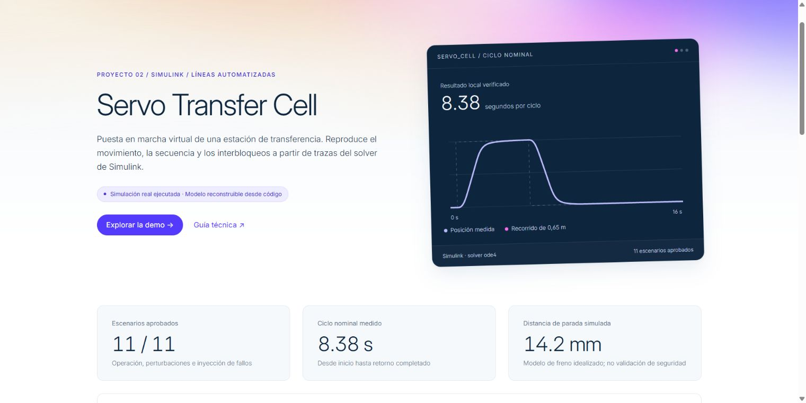
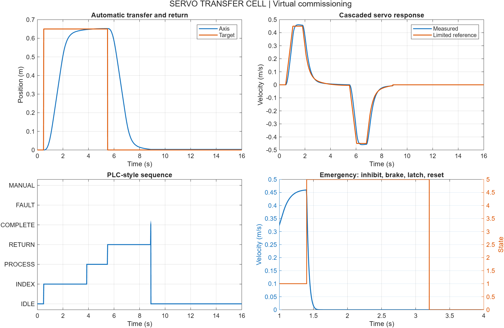

# Servo Transfer Cell — virtual commissioning in Simulink

A simulated transfer axis for an automated production cell: index a part to a work station, wait for its acknowledgment, return home, and finish exactly one cycle per start command.

**Simulink project · MIT source code · SI-unit physical model · source-rebuildable `.slx` model.**

[**Open the interactive demo →**](https://alejandropedersen123-collab.github.io/servo-cell-simulink/)



The presentation uses the owner's selected visual system with a locally bundled Inter font. See [visual tokens and font attribution](docs/design-system.md).



## Engineering scope

- PLC-style sequence with IDLE, INDEX, PROCESS, RETURN, COMPLETE, FAULT and MANUAL states.
- Cascaded position P / velocity PI control with acceleration limiting, force saturation and back-calculation anti-windup.
- Explicit first-out alarm, fault latching, disabled-only reset and separate restart action.
- Continuous mass/friction/brake model coupled to a 10 ms control scan and a 2 ms fixed-step plant solver.
- Eleven executable acceptance scenarios: nominal, extra payload/load, emergency, invalid encoder, missing part, process timeout, stale acknowledgment, held start, travel limit, weak actuator and manual jog.

## Run

From this folder in MATLAB R2026a with Simulink:

```matlab
addpath(pwd)
modelFile = build_model;
open_system(modelFile)
T = simulate_scenario('nominal');
results = runtests('tests'); assertSuccess(results)
report = run_acceptance;
% Or run the unit tests and full acceptance suite together with: validate
```

`build_model` reconstructs `models/servo_transfer_cell.slx` from text sources. It closes an already-loaded model with that name without saving in-memory changes, so save manual edits under a new name first. `simulate_scenario` uses `Simulink.SimulationInput` to isolate each run's commands, mass and actuator limit. MATLAB and Simulink are proprietary runtime requirements; the project code is open source.

## Inspect the evidence

| Artifact | Purpose |
|---|---|
| `results/acceptance.csv` | Scenario pass status and measured metrics |
| `results/summary.json` | Machine-readable local results and MATLAB version |
| `results/nominal.csv` | Position, velocity, force, sequence, alarms and cycles |
| `results/emergency_stop.csv` | Scan response, brake motion and reset behavior |
| `results/model.png` | Generated Simulink block diagram |

Acceptance assertions execute against the **actual Simulink solver**, not only a separate numerical mock. Unit tests exercise explicit-memory control functions directly. See [requirements](docs/requirements.md) for traceability and [architecture](docs/architecture.md) for equations and assumptions.

[Open the offline playback demo](docs/demo.html) to replay position, velocity, sequence and alarms without MATLAB. It displays recorded simulation traces and does not run a new simulation.

The measured nominal cycle takes **8.38 s**. With 50% extra mass and a temporary 5 N disturbance, it takes **10.19 s**, including a later station acknowledgment at 7 s. This is not a pure controller-speed comparison because the acknowledgment timing also changes. Maximum loaded travel is 0.6604 m for a 0.65 m target. All 11 acceptance scenarios and seven unit tests passed locally on R2026a Update 5 and also [passed in GitHub Actions](https://github.com/alejandropedersen123-collab/servo-cell-simulink/actions/runs/39823711569).

After regenerating results, `python tools/build_demo.py` rebuilds the standalone viewer using Python 3 and its standard library. This optional step does not require MATLAB or external web assets.

## Process and control

The simulated axis travels 0.65 m. A part-present input permits the start edge. Completion of a move requires both position and velocity tolerances to hold for 120 ms; crossing the target at speed cannot falsely complete the move. A work-station acknowledgment then releases the return move. A held start input cannot automatically repeat the cycle.

The plant uses `m*x_ddot = Fmotor - b*v - Fc*tanh(v/0.01) - Fload - brake*B*v`. Nominal mass is 8 kg; force is limited to ±35 N. The velocity reference is limited to ±0.45 m/s and 0.8 m/s². Parameters and units live in `+cellctl/parameters.m`.

## Intended industrial integration

The [I/O map](docs/io-map.csv) uses semantic tags rather than assumed PLC addresses. The sequence is expressed as scan logic with explicit memory to make review and porting easier. This repository does **not** claim that PLC code has been generated, compiled or deployed, or that a robot, drive, OPC UA server or fieldbus has been connected.

The emergency input models motor-command inhibition, a viscous brake and a latched fault. This is a software demonstration of interlock behavior, **not a certified safety function**. Measured simulated stopping distance does not establish PL/SIL, drive STO performance, braking capacity or real stopping time. A real cell requires independent safety design, hardware validation and risk assessment.

## Learning and contribution

See the [Spanish interview guide](docs/defensa-es.md). Useful next steps are adding a drive delay, an encoder quantizer, hardware-in-the-loop commissioning, and a reviewed PLC implementation. These are intentionally listed as future work.

Created as an AI-assisted portfolio project for Alejandro Pedersen. The model and tests are original demonstrator code; they do not imply prior industrial deployment. Source code is licensed under MIT. MathWorks products and any third-party dependencies retain their own licenses.

References: [programmatic MATLAB Function blocks](https://www.mathworks.com/help/simulink/ug/configure-matlab-function-blocks-programmatically.html), [anti-windup concepts](https://www.mathworks.com/help/simulink/slref/anti-windup-control-using-a-pid-controller.html), [From Workspace behavior](https://www.mathworks.com/help/simulink/slref/fromworkspace.html).
