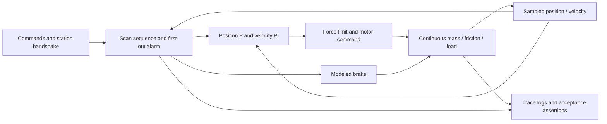

# Architecture and assumptions

## Timing

Control scan: 10 ms. Plant: fixed-step RK4, 2 ms. Encoder signals are sampled with Zero-Order Hold blocks. Command transitions are scan-aligned and zero-order-held. The input block holds the final row rather than extrapolating. Each simulation reinitializes persistent function-block memory. Controller functions also accept memory explicitly for unit testing.

## Control equations

`v_desired = clamp(Kpos * (target - x), -vmax, vmax)`; in MANUAL, the jog request replaces the position law. Reference acceleration is bounded each scan. `Fraw = Kp * (vref-v) + I`; `F = clamp(Fraw, -Fmax, Fmax)`. The integral contribution advances by `Ts*(Ki*(vref-v) + Kaw*(F-Fraw))`.

IDLE, COMPLETE and FAULT set motor command to zero, reset control memory and apply the modeled brake. PROCESS remains actively position-controlled. Transitions from motion to an inhibited state prioritize command inhibition over a smooth reference. The model does not contain a drive communication delay or hardware brake dynamics.

## Sequence contract

Only a rising start edge, valid part-present input, enabled automatic mode and home position can begin a cycle. INDEX and RETURN require position AND speed tolerances to remain true for the settle time. PROCESS waits for a new acknowledgment rising edge or trips on timeout; an input already high before arrival is rejected. COMPLETE waits for start release. FAULT preserves the first cause and can clear only with a new reset edge while disabled and with healthy inputs. The loaded scenario supplies its acknowledgment at 7 s rather than the nominal 5.5 s because the heavier axis settles later.

Alarm codes: 1 emergency request; 2 invalid encoder; 3 travel limit; 4 movement timeout; 5 station acknowledgment timeout; 6 start away from home. The start-away-from-home interlock means an emergency mid-travel cannot be followed by blind automatic restart. Recovery/homing requires an operator procedure; automatic homing is not implemented.

## Physical assumptions

One rigid translational axis; no compliance, backlash, electrical dynamics, network jitter or motor thermal limit. Friction has viscous and smoothed Coulomb terms. A viscous brake is a numerical approximation, not a model of any particular physical brake. Nominal plant parameters and controller settings are illustrative. Extra-payload and load-pulse tests probe a limited envelope, not universal robustness.

## Reproducibility

The `.slx` binary is generated from `build_model.m` and the `+cellctl` package. The model workspace includes a default input and parameter vector so opening the file is inspectable. Scenario simulations override these through `SimulationInput`; they do not depend on variables from a user's base workspace. Text sources are the reviewable source of truth.
